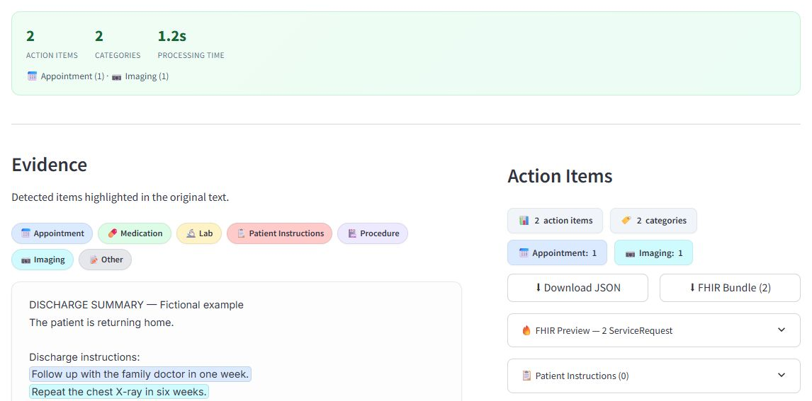

# EHR Discharge Analyser

**Extract and review follow-up actions from English discharge summaries.**

[Live demo](https://huggingface.co/spaces/Dwagga/ehr-discharge-analyser) · [Portfolio](https://davidmendezmerino.com/) · [Source revision](SOURCE.md)



EHR Discharge Analyser turns discharge-summary text into grouped follow-up actions, with the source sentences available for review. It combines BioBERT-based sentence embeddings and multi-label classification with a FastAPI backend and a Streamlit interface.

## What it does

- Identifies **Patient Instructions, Appointment, Medication, Lab, Procedure, Imaging and Other** actions. A sentence can receive more than one label.
- Recognises document sections and splits actionable text into sentences before classification.
- Groups the extracted items and highlights their supporting text in the original document.
- Provides structured JSON and an illustrative FHIR-like bundle export.
- Packages the API and interface together for Docker and Hugging Face Spaces.

The implementation includes application integration, sentence/section processing, review UI and deployment. The encoder is based on an existing BioBERT sentence-transformer model; its source is recorded in [SOURCE.md](SOURCE.md).

## Run locally with Docker

Python 3.11 or newer is needed only for the artifact-download helper. Docker runs the application in a Python 3.11 image with the declared application dependencies.

```sh
git clone https://github.com/Davidmendezmerino/ehr-discharge-analyser.git
cd ehr-discharge-analyser
python scripts/download_artifacts.py
docker build -t ehr-discharge-analyser .
docker run --rm -p 127.0.0.1:7860:7860 ehr-discharge-analyser
```

Open **http://127.0.0.1:7860**. The interface talks to the FastAPI process inside the container. The first prediction loads the local encoder.

Model weights and classifier artifacts are excluded from Git. The helper downloads the files needed at runtime from the pinned public Space and verifies their recorded file sizes and hashes. The manifest contains the exact source revision and expected files. Existing files with different contents are preserved and reported as errors.

## Run the two services without Docker

Use a Python 3.11 or 3.12 virtual environment. From the repository root, after activating that environment:

```sh
python -m pip install -r app/api/requirements.txt -r app/ui/requirements.txt
python scripts/download_artifacts.py
```

In one terminal, with the same environment active:

```sh
cd app/api
python -m uvicorn main:app --host 127.0.0.1 --port 8000
```

In another terminal, from the repository root:

```sh
python -m streamlit run app/ui/app.py --server.address 127.0.0.1 --server.port 7860
```

The UI defaults to `http://localhost:8000`; `API_URL` can select another API address. API documentation is available at **http://127.0.0.1:8000/docs**. Main routes: `GET /health` and `POST /clip/infer`, with a JSON body containing `text`.

## Scope

This repository contains the application originally deployed on Hugging Face, with the reliability fixes listed in [SOURCE.md](SOURCE.md). It does not include a training pipeline or an independently validated clinical system. No clinical performance, time saving or hospital use is claimed. The FHIR-like export is a demonstration and is not a conformance claim. The unused `/clip/extract` and `/deid/redact` placeholder routes explicitly return HTTP 501; extraction is provided by `/clip/infer`, and de-identification is not implemented. Use the supplied examples or synthetic text when trying the public demo.

## Run the regression checks

In an activated environment, from the repository root:

```sh
python -m pip install -r requirements-dev.txt
python -m unittest discover -s tests -v
```

The tests cover HTTP behaviour, missing-artifact instructions, repeated sentences, source offsets and classification thresholds. They do not download the encoder or measure clinical accuracy. A local CPU smoke test using the pinned model files was also completed with Python 3.12; this does not establish performance on a clinical dataset.

## Repository layout

| Path | Contents |
| --- | --- |
| `app/api/ml/predictor.py` | Encoder loading, section processing and sentence classification |
| `app/api/services/` | Inference and source-span integration |
| `app/api/models/` | Request and response schemas |
| `app/ui/app.py` | Streamlit review interface |
| `scripts/download_artifacts.py` | Download and verify the runtime artifacts |
| `artifacts.manifest.json` | Pinned artifact provenance and integrity values |
| `Dockerfile`, `start.sh` | Container and service entry points |
| `tests/` | API, evidence and threshold regression checks |

**Author:** David Méndez Merino. The original Space declares Apache-2.0 for this application. Pretrained models retain their own terms and attribution; see [SOURCE.md](SOURCE.md).
